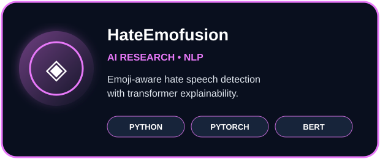
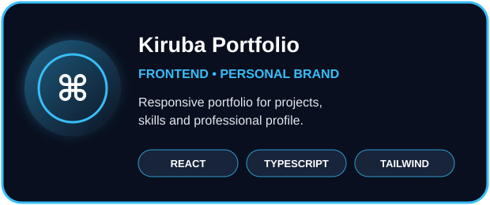
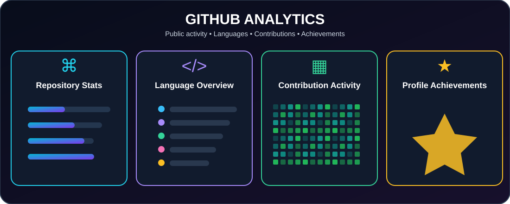

  

  <h1>Hi, I&apos;m Kirubaharan</h1>
  <h3>Full-stack developer · AI applications · security-minded engineering</h3>

  

  

    
    
    
  

  
  

## About me

I&apos;m a full-stack developer from **Sankarankovil, India** who enjoys building practical web applications and exploring how AI can make them more useful. My public GitHub profile describes my interests in user-friendly applications and lists **HTML, CSS, JavaScript, and Java**; my projects also show work with **Python, React, and TypeScript**.

- Exploring agentic AI with **Google ADK and Gemini**.
- Interested in application development, automation, and cybersecurity—especially **CyberArk PAM**.
- Learning by building and sharing projects, from web apps to Java problem-solving.

## What I work with

| Area | Tools & technologies |
|:--|:--|
| Languages & web | Java · Python · JavaScript · HTML · CSS · TypeScript |
| Web development | React · portfolio and web application projects |
| AI application | Google ADK · Gemini · Python · FastAPI · Cloud Run (TN Workout Coach project) |
| Learning focus | CyberArk PAM · IAM · agentic AI security |

  
<strong>Technology badges</strong>

   
  

    
  

## Featured projects

  
  
  
  

### More from my GitHub

- [SDLC Agentic Skills](https://github.com/kirubaharan181/sdlc-agentic-skills) — agentic skills for software development workflows.
- [Sentiment Analysis](https://github.com/kirubaharan181/Sentiment_Analysis) — deep-learning approaches to product-review sentiment and ranking.
- [Scoodemy](https://github.com/kirubaharan181/Scoodemy__An-E-Learning-Platform) — Java e-learning platform.

## GitHub activity

  
    
  <picture>
    <source media="(prefers-color-scheme: dark)" srcset="https://raw.githubusercontent.com/kirubaharan181/kirubaharan181/output/github-snake-dark.svg" />
    
  </picture>

## Currently exploring

  

- Building and refining AI-assisted applications and agent workflows.
- Learning more about secure privileged access and identity management.
- Practicing Java data structures and algorithms.

## Let&apos;s connect

  
  
  
    
  

