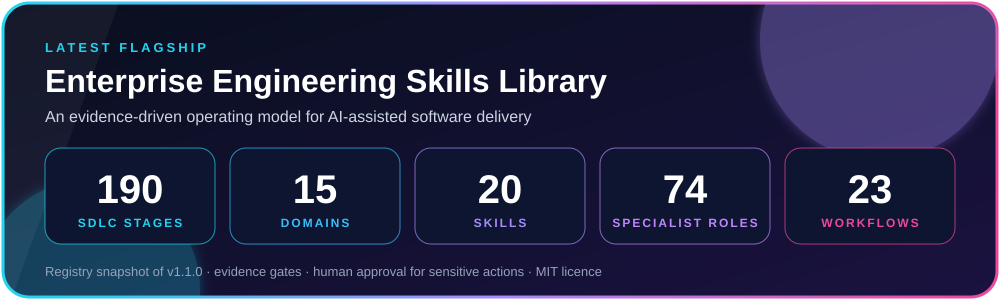
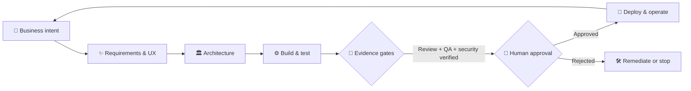
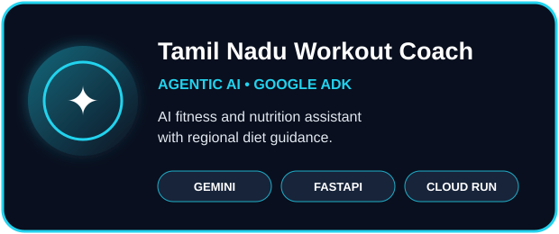
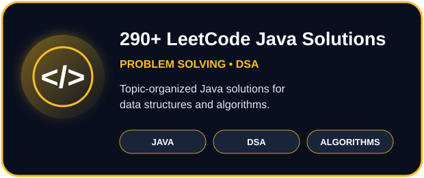
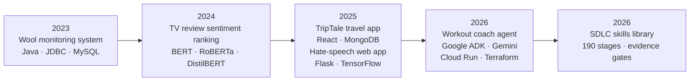
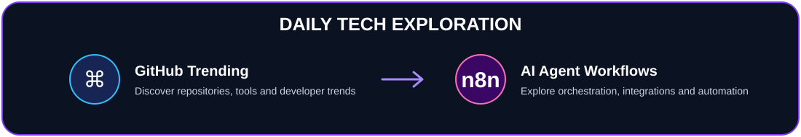

<!--
  Profile README: Kirubaharan (kirubaharan181)
  Location: Sankarankovil, Tenkasi, Tamil Nadu, India
  Focus: Java / Python development, agentic AI on Google Cloud, security-aware engineering
  Portfolio: https://kirubaharan181.github.io/kiruba-portfolio/
  Rule for this file: every number and technology below is backed by a public repository,
  my resume, or my own statement about my work. Sections marked "auto-generated" are written by GitHub Actions.
-->

  

   

  

   

  
  
  

    

  
  
  
  

    

  <a href="#about">About</a> · <a href="#flagship-project">Flagship</a> · <a href="#technology-ecosystem">Stack</a> · <a href="#evidence-map">Evidence</a> · <a href="#featured-projects">Projects</a> · <a href="#build-journey">Journey</a> · <a href="#experience-and-education">Experience</a> · <a href="#github-dashboard">Dashboard</a> · <a href="#connect">Connect</a>

## About

### Software Developer | Agentic AI | Cybersecurity & Cloud

I build practical software applications, intelligent AI-powered systems, and automation solutions. My interests span full-stack development, agentic AI architectures, cloud technologies, and cybersecurity. I enjoy turning ideas into useful applications while continuously strengthening my engineering, problem-solving and security skills.

| | Focus | What it means in practice |
|:-:|---|---|
| 💻 | **Software engineering** | Java, Python, React, TypeScript, REST APIs and database-driven applications |
| 🤖 | **Agentic AI** | Google ADK, Gemini, AI agents, tool integration, memory and automation; exploring RAG |
| 🔐 | **Cybersecurity** | CyberArk Privileged Access Management (PAM), identity security, and exploring AI agent security |
| ☁️ | **Cloud & DevOps** | Google Cloud, Docker, Terraform, CI/CD and cloud-native application development |

**Right now:** building full-stack and backend applications, developing AI agents with tool integration and memory, working with CyberArk PAM, and improving software architecture and development practices.

## Flagship project

  
   
  
  
  

**[sdlc-agentic-skills](https://github.com/kirubaharan181/sdlc-agentic-skills)** is an evidence-driven operating model for AI-assisted software delivery. It connects 190 SDLC stage definitions, 20 skills, 74 specialist role contracts and 23 workflow routes, and a validator rejects unresolved references and unlabelled example evidence.

> **Honest status:** "complete" here means authored and structurally validated. The example validation commands have not been run against a real project, and the worked examples are labelled illustrative. Counts above are a snapshot of v1.1.0 and can be reproduced with `make build` in the repository.

## Technology ecosystem

Grouped by how much proof is behind each item, so nothing here is just a logo.

### ✅ Used in my public repositories

 

 

 

 

### 📄 Listed on my resume

### 🔐 Cybersecurity training and focus

<strong>🧭 Currently exploring (no public project yet)</strong>

 

 

## Evidence map

Each claim points at the files that prove it.

| Capability | Repository | What you can verify |
|---|---|---|
| Agentic AI on Google ADK + Gemini | [buildwithgemini-tn-workout-coach](https://github.com/kirubaharan181/buildwithgemini-tn-workout-coach) | `pyproject.toml` pins `google-adk` and `fastapi`; 11 test modules across `tests/unit`, `tests/integration` and `tests/eval` |
| Cloud Run deployment and infrastructure as code | [buildwithgemini-tn-workout-coach](https://github.com/kirubaharan181/buildwithgemini-tn-workout-coach) | `Dockerfile` and 10 Terraform files in `deployment/terraform/single-project/` |
| Agent memory on Firestore | [buildwithgemini-tn-workout-coach](https://github.com/kirubaharan181/buildwithgemini-tn-workout-coach) | `app/memory.py` and `seed_firestore.py` |
| NLP research with explainability | [HateEmofusion](https://github.com/kirubaharan181/HateEmofusion) | `requirements.txt` pins `torch`, `transformers`, `shap`, `lime` and `bertviz` |
| Deep-learning sentiment analysis | [Sentiment_Analysis](https://github.com/kirubaharan181/Sentiment_Analysis) | BERT, DistilBERT, RoBERTa, TextCNN and TextRNN comparison in a notebook |
| Flask + Keras web application | [Twitter_Hateful_analysis](https://github.com/kirubaharan181/Twitter_Hateful_analysis) | `requirements.txt` pins Flask 3.1.0, TensorFlow 2.19.0 and Keras 3.9.0 |
| React + TypeScript with CI/CD | [kiruba-portfolio](https://github.com/kirubaharan181/kiruba-portfolio) | React 18, Vite 5, Tailwind 3, TypeScript 5 and a GitHub Pages `deploy.yml` workflow |
| Java desktop apps with MySQL | [Scoodemy](https://github.com/kirubaharan181/Scoodemy__An-E-Learning-Platform), [Wool_Management](https://github.com/kirubaharan181/Wool_Management) | Maven on Java 21 with MySQL connector and JUnit 5; 29 NetBeans Swing forms |
| Data structures and algorithms | [300_Leetcode_Solved_Solutions](https://github.com/kirubaharan181/300_Leetcode_Solved_Solutions) | 293 distinct problems with Java solutions, organised by topic |
| Engineering governance and CI | [sdlc-agentic-skills](https://github.com/kirubaharan181/sdlc-agentic-skills) | 4 GitHub Actions workflows, validation scripts and 10 Python test modules |

## Featured projects

  
  
  
  

## Build journey

2023–2025 entries come from my resume; the 2025 hate-speech app and both 2026 entries match the last-updated dates of their public repositories.

## Experience and education

### 💼 Cognizant: Programmer Analyst Trainee
*Joined: July 2026*

Building my professional software engineering foundation through technical learning, problem-solving and practical development experience.

### 🔐 Cybersecurity training
- **CyberArk On-Premises Administration:** completed training and developing practical knowledge of Privileged Access Management (PAM).

### 🎓 Education
| | Qualification | Institution | Years |
|:-:|---|---|:-:|
| 🎓 | B.Tech Information Technology (GPA 7.47 / 10) | Mepco Schlenk Engineering College, Sivakasi | 2022 – 2026 |
| 🏫 | Higher Secondary 92% · SSLC 89% | Sri Gomathi Ambal Matric HSS, Sankarankovil | 2020 – 2022 |

### 🏆 Certifications and achievements
- **Certifications:** Infosys Java Programming · Infosys SQL · Infosys Agile Methodology · Power BI. Training and certification areas I also work in: Privileged Access Management (PAM) and Generative AI.
- **Symposium:** presented a deep learning project on sentiment analysis at a national-level tech symposium.
- **Problem solving:** 293 LeetCode problems solved in Java in [this repository](https://github.com/kirubaharan181/300_Leetcode_Solved_Solutions).
- **Training:** completed Oracle's one-week Java workshop on enterprise-level development.
- **Agentic AI project:** built an AI application with Google ADK and Gemini, deployed on Google Cloud Run.

### 🔐 Cybersecurity and AI security focus
- **CyberArk PAM:** On-Premises Administration training and hands-on learning in Privileged Access Management.
- **Identity and Access Management:** privileged access, identity security, authentication and authorization.
- **AI agent security:** exploring secure agent identities, credential protection, least-privilege access and tool permissions.
- **Cloud security:** learning secure configuration, access control and secrets management for cloud applications.

## GitHub dashboard

  
    
  
  
    
  <picture>
    <source media="(prefers-color-scheme: dark)" srcset="https://raw.githubusercontent.com/kirubaharan181/kirubaharan181/output/github-snake-dark.svg" />
    
  </picture>

📈 Widgets not loading?

 

These cards come from free third-party services that sometimes time out or serve cached data. Live numbers are always on my [repositories tab](https://github.com/kirubaharan181?tab=repositories).

### Recently updated repositories
Auto-generated daily by GitHub Actions from the public repository API.

<!--START_SECTION:recent-repos-->
| Repository | Last updated |
|---|---|
| [sdlc-agentic-skills](https://github.com/kirubaharan181/sdlc-agentic-skills) | 24 Nov 2026 |
| [Scoodemy__An-E-Learning-Platform](https://github.com/kirubaharan181/Scoodemy__An-E-Learning-Platform) | 03 Nov 2026 |
| [buildwithgemini-tn-workout-coach](https://github.com/kirubaharan181/buildwithgemini-tn-workout-coach) | 26 Sep 2026 |
| [Wool_Management](https://github.com/kirubaharan181/Wool_Management) | 26 Apr 2026 |
| [kiruba-portfolio](https://github.com/kirubaharan181/kiruba-portfolio) | 24 Apr 2026 |
<!--END_SECTION:recent-repos-->

## Current direction

  

- Daily exploring GitHub Trending repositories to discover useful projects, developer tools and emerging technologies.
- Learning to design and orchestrate AI-agent workflows with n8n and connected platforms.
- Improving AI-agent reliability, tool permissions, credential handling and safe automation boundaries.
- Strengthening CyberArk PAM, IAM, Java problem solving and cloud security knowledge.

## Connect

  
  
  
    
  

