<!-- GitHub profile README for Kirubaharan. Public project evidence only. -->

<div align="center">
  

  <br/>

  <a href="https://github.com/kirubaharan181">
    
  </a>

  <br/><br/>

  <a href="https://kirubaharan181.github.io/kiruba-portfolio/"></a>
  <a href="https://www.linkedin.com/in/kiruba-haran-7369a0320"></a>
  <a href="mailto:kirubakrishkk@gmail.com"></a>

  <br/><br/>

  
  
</div>


## About

```text
Software Developer
Focus: Java · Python · React · TypeScript · SQL
Building: AI agents · automation workflows · applied machine learning
Exploring: cloud delivery · secure engineering · developer tooling
```

I build practical software with an emphasis on clear engineering, useful automation, and evidence-based technical communication. This profile reflects public project work and learning in progress—not inflated claims.


## Technology ecosystem

<div align="center">
  
  <br/>
  
  <br/>
  
  <br/>
  
</div>


## Featured projects

<div align="center">
  <a href="https://github.com/kirubaharan181/buildwithgemini-tn-workout-coach"></a>
  <a href="https://github.com/kirubaharan181/kiruba-portfolio"></a>
  <br/>
  <a href="https://github.com/kirubaharan181/HateEmofusion"></a>
  <a href="https://github.com/kirubaharan181/300_Leetcode_Solved_Solutions"></a>
</div>

| Project | Verified focus |
| --- | --- |
| [Tamil Nadu Workout & Nutrition Coach](https://github.com/kirubaharan181/buildwithgemini-tn-workout-coach) | Google ADK/Gemini agent, FastAPI, Firestore memory, Cloud Run, tests and evaluations |
| [Kiruba Portfolio](https://kirubaharan181.github.io/kiruba-portfolio/) | React, TypeScript, Vite, Tailwind CSS, GitHub Pages |
| [HateEmofusion](https://github.com/kirubaharan181/HateEmofusion) | Emoji-aware hate-speech research using PyTorch and Transformers |
| [300 LeetCode Java Solutions](https://github.com/kirubaharan181/300_Leetcode_Solved_Solutions) | Java data structures and algorithm practice organized by topic |


## GitHub dashboard

<div align="center">
  
  
  <br/>
  
  <br/>
  
  <br/>
  
  <br/><br/>
  <picture>
    <source media="(prefers-color-scheme: dark)" srcset="https://raw.githubusercontent.com/kirubaharan181/kirubaharan181/output/github-snake-dark.svg" />
    
  </picture>
</div>

<details>
  <summary>Dashboard fallback</summary>

  The cards above use public GitHub data through third-party image services and may occasionally be cached or unavailable. Live repository data is always available on the [GitHub profile](https://github.com/kirubaharan181) and [repository list](https://github.com/kirubaharan181?tab=repositories).
</details>


## Current direction

- Improving AI-agent systems with reliable tools, evaluation, and safe boundaries.
- Developing automation workflows for curated GitHub and market digests.
- Strengthening Java problem solving, software design, and cloud delivery practices.
- Exploring secure engineering practices for modern AI-enabled applications.


## Connect

<div align="center">
  <a href="https://kirubaharan181.github.io/kiruba-portfolio/"></a>
  <a href="https://www.linkedin.com/in/kiruba-haran-7369a0320"></a>
  <a href="mailto:kirubakrishkk@gmail.com"></a>
  <br/><br/>
  
</div>
