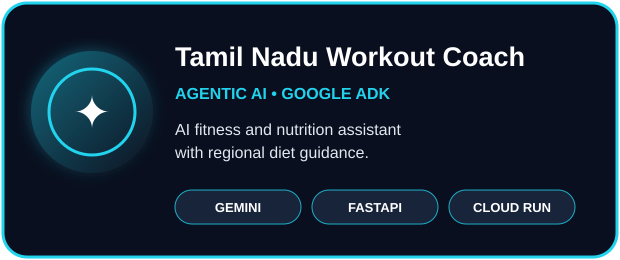
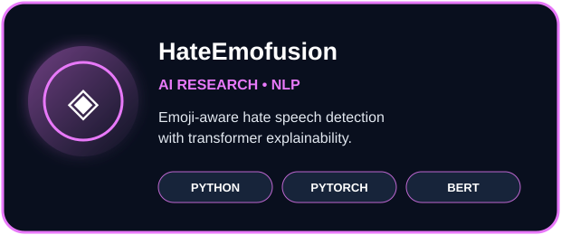
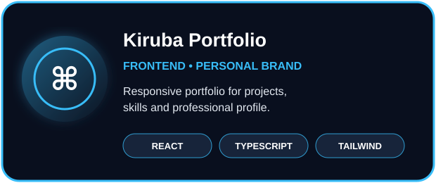
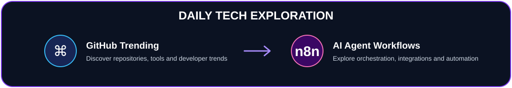

<!-- GitHub profile README for Kirubaharan. Public project evidence only. -->

  

   

  

    

  
  
  

    

  
  

## About

### Software Developer | Agentic AI | Cybersecurity & Cloud

I build practical software applications, intelligent AI-powered systems, and automation solutions. My interests span full-stack development, agentic AI architectures, cloud technologies, and cybersecurity.

**My engineering focus:**
- 💻 **Software Engineering:** Java, Python, React, TypeScript, REST APIs and database-driven applications.
- 🤖 **Agentic AI:** Google ADK, Gemini, AI agents, RAG, tool integration and intelligent automation.
- 🔐 **Cybersecurity:** Hands-on work with CyberArk Privileged Access Management (PAM), privileged account security, identity security and exploring AI agent security.
- ☁️ **Cloud & DevOps:** Google Cloud, Docker, CI/CD and cloud-native application development.

I enjoy turning ideas into useful applications while continuously strengthening my engineering, problem-solving and security skills.

### 🚀 About Me

I'm a software developer interested in building reliable applications and exploring how AI and cybersecurity can shape the future of software engineering.

My current focus includes:

- Building full-stack applications and backend services.
- Developing AI agents with tool integration, memory and automation capabilities.
- Exploring Retrieval-Augmented Generation (RAG) and practical LLM applications.
- Working with CyberArk PAM and strengthening my knowledge of identity and privileged access management.
- Exploring security considerations for AI agents and cloud-based systems.
- Improving software architecture, problem-solving and development practices.

I believe in continuous learning, practical implementation and building technology that solves real-world problems.

## Technology ecosystem

  
   
  
   
  
   
  

## Featured projects

  
  
  
  

## 🏆 Certifications, Training & Achievements

- 🔐 **CyberArk PAM:** Completed CyberArk On-Premises Administration training and continuing to develop practical knowledge of Privileged Access Management.
- 💻 **Problem Solving:** Built a collection of 300 Java solutions covering LeetCode data structures and algorithms.
- 🤖 **Agentic AI:** Developed an AI-powered application using Google ADK and Gemini.
- ☁️ **Cloud Development:** Explored deployment of AI-powered applications using Google Cloud and Cloud Run.

## 🔐 Cybersecurity & AI Security

My cybersecurity learning and development focus:

- **CyberArk PAM:** On-Premises Administration training and hands-on learning in Privileged Access Management.
- **Identity & Access Management (IAM):** Privileged access, identity security, authentication and authorization.
- **AI Agent Security:** Exploring secure AI agent identities, credential protection, least-privilege access and tool permissions.
- **Cloud Security:** Learning secure configurations, access control and secrets management for cloud applications.

**Current specialization:** CyberArk PAM | IAM | Privileged Access Security | AI Agent Security

## GitHub dashboard

  
    
  <picture>
    <source media="(prefers-color-scheme: dark)" srcset="https://raw.githubusercontent.com/kirubaharan181/kirubaharan181/output/github-snake-dark.svg" />
    
  </picture>

## Current direction

  

- Daily exploring GitHub Trending repositories to discover useful projects, developer tools and emerging technologies.
- Learning to design and orchestrate AI-agent workflows with n8n and connected platforms.
- Improving AI-agent reliability, tool permissions, credential handling and safe automation boundaries.
- Strengthening CyberArk PAM, IAM, Java problem solving and cloud security knowledge.

## Connect

  
  
  
    
  

